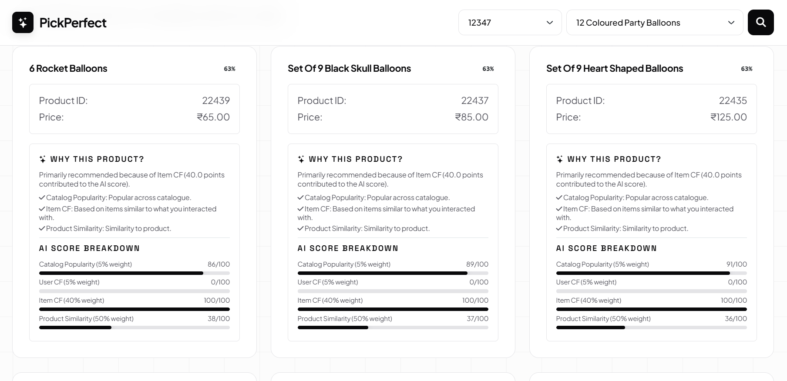

# Product Recommendation System

Problem Statement: Digital commerce containing thousands or even millions of products, leads to information overload and no personalization

Solution: An end-to-end Machine Learning project designed to recommend products based on user preference by hybrid model combining time aware popularity, user-based and item-based collaborative filtering, content-based filtering model.



## Tech Stack
- Data Science: NumPy, Pandas, Matplotlib, Seaborn, Scikit-Learn
- Machine Learning: Collaborative Filtering, Content-based Filtering, PyTorch.
- Deployment: HTML5, CSS3, Bootstrap, Git, GitHub and Render Platform.

## Setup Installation
```
pip install pandas numpy matplotlib seaborn scikit-learn joblib
git clone https://github.com/ujjwalkumar14b/Recommendation.git
cd Recommendation
```

## Author
Ujjwal Kumar
GitHub: [https://github.com/ujjwalkumar14b](https://github.com/ujjwalkumar14b)
